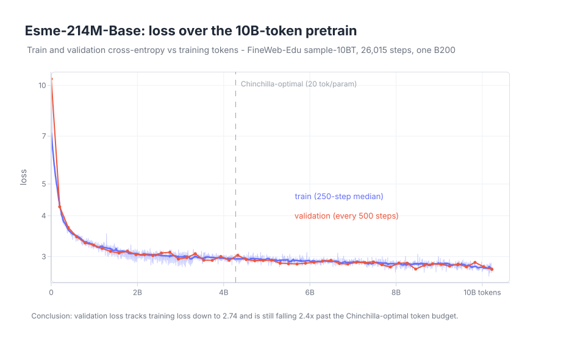
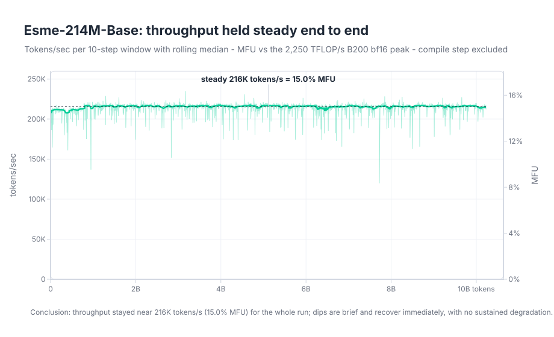

# esme-pretrain

 

`esme-pretrain` trains a small language model from raw text and measures how
its training recipe behaves as the model grows. It produced `Esme-214M-Base`,
a 214M-parameter dense decoder trained from scratch on 10.2B tokens of
FineWeb-Edu, and exports it for the [Esme serving and posttraining
repos](#related-repositories).

The model and training code are plain PyTorch, with no `transformers`,
`Trainer`, or `accelerate`. The throughput benchmark and the scaling study each
fix their question, method, and predictions in a run card before any GPU time
is spent, and commit their raw result rows.

## Results

### The base model beats two public baselines

`Esme-214M-Base` against two pinned public base models:
[Cerebras-GPT-256M](https://huggingface.co/cerebras/Cerebras-GPT-256M) (5.1B
training tokens) and [Pythia-160M](https://huggingface.co/EleutherAI/pythia-160m)
(about 22x Esme's training compute). All three run deterministic fp32 forward
passes on identical inputs. The harness must first reproduce Cerebras's
published 0-shot table, and it matched every task within ±0.002.

| 0-shot task | Esme-214M-Base | Cerebras-GPT-256M | Pythia-160M |
| --- | --- | --- | --- |
| arc_challenge | **0.244** | 0.169 | 0.195 |
| arc_easy | **0.581** | 0.410 | 0.436 |
| hellaswag | **0.325** | 0.274 | 0.284 |
| lambada_openai | 0.307 | 0.294 | **0.354** |
| openbookqa | **0.206** | 0.158 | 0.150 |
| piqa | **0.659** | 0.614 | 0.623 |
| winogrande | **0.531** | 0.513 | 0.513 |
| **average** | **0.408** | 0.347 | 0.365 |

Esme wins 6 of 7 tasks. The task suite is close to FineWeb-Edu's educational
content, and the one loss, LAMBADA, is fiction, which FineWeb-Edu barely
covers. Bits per byte on identical text shows the same domain split: each model
predicts the text closest to its own training data best.

| Bits per byte | Esme-214M-Base | Cerebras-GPT-256M | Pythia-160M |
| --- | --- | --- | --- |
| FineWeb-Edu validation | **0.901** | 1.065 | 1.017 |
| Pile test | 1.283 | 0.955 | **0.902** |

### Training runs 1.57x faster on the same GPU

A before/after benchmark on one B200 measured the production 214M training
step at `418,466` tokens/sec, against `266,478` for the code and data path that
trained the base model. MFU went from 18.6 to 29.1 percent and peak memory from
40.7 to 27.3 GB. On the production path, one host sync per step, native
grouped-query attention, and a compiled loss give 1.21x, and pre-tokenized,
shuffled token shards give a further 1.30x. Five predictions were written before the benchmark ran,
and the [run card](docs/run-cards/throughput-bench-b200.md) scores each one.

### Deeper models want a lower learning rate

The base model trained at LR `6e-4`. A sweep over four depths at a fixed width
of 768, each trained for 0.5B tokens, shows that this LR is too low at every
depth over a short run, and that the best LR is lower for deeper models:

| Model (non-embedding params) | Best LR tested | Loss cost of `6e-4` |
| --- | --- | ---: |
| 38M | `4.8e-3` (top of the grid) | 0.139 nats |
| 76M | `2.4e-3` to `4.8e-3` (tied) | 0.106 nats |
| 113M | `2.4e-3` | 0.090 nats |
| 189M (the base model's shape) | `2.4e-3` | 0.087 nats |

The grid steps by 2x and each cell is one seed. Short runs favor high learning
rates, so the cost at 0.5B tokens likely overestimates what `6e-4` cost the full
10.2B-token run. The rules for picking each
size's LR were written down before each batch of runs. The
[scaling-study run card](docs/run-cards/scaling-study-b200.md#learning-rate-selection)
records them.

### Next: predict the base model's loss from smaller models

The scaling study fits `L(N, D) = E + A/N^α + B/D^β` on 12 loss points: 3 model
sizes (38M to 113M non-embedding parameters), each at 4 token budgets and its
swept LR. It then predicts the base model's validation loss, commits that
prediction, and only then scores the real checkpoint. Three sizes pin the
parameter term only loosely, and the 214M point sits 1.7x beyond the largest
fit size. The base model also trained with a different LR, no data shuffle,
and a longer warmup, so the test covers transfer across those differences
too. The
fit method, the predictions, and the pass criteria are fixed in the
[run card](docs/run-cards/scaling-study-b200.md), and the launcher refuses to
score the 214M checkpoint until a matching prediction is committed.

## Training Telemetry

The base model's run, plotted from its `metrics.jsonl` and `throughput.csv`:





Each in-loop validation point in this run scored different batches, so that
curve carries sampling noise. The fixed post-run eval (CE `2.7756`, `0.9005`
bits per byte over 10M validation tokens) is the reference number.

## How It Works

- **Data.** FineWeb-Edu `sample-10BT` at a pinned revision, split once by a
  hash of each document id. The base model trained on the tokenized stream in
  dataset order. The benchmark and the scaling study read uint16 token shards
  from `pretokenize` in a seeded, resumable order.
- **Tokenizer.** Byte-level BPE with a 32,768 vocab and digit splitting.
- **Model.** [`DenseBackbone`](src/esme_pretrain/modeling/backbone.py): 30
  layers at `d_model=768`, grouped-query attention, RoPE, RMSNorm, SwiGLU,
  QK-norm, tied embeddings, and z-loss.
- **Training.** WSD learning-rate schedule, bf16, `torch.compile`, fused AdamW,
  token-accurate resume, and cooldown branches that fork a shorter run from a
  longer run's checkpoint.
- **Evaluation and export.** A fixed, hash-checked validation set for every
  checkpoint, bits per byte, decoded samples, a public-baseline harness, and an
  `llm-infer` export bundle with per-file hashes.
- **Experiments.** Modal launchers for the scaling study and the throughput
  benchmark. Each one prices itself before it runs, refuses to start without
  `--approved` and a spend cap, and writes each result to a volume as it
  finishes.

[`docs/architecture.md`](docs/architecture.md) covers the design and the
conventions that matter when you compare runs.

## Quickstart

Install the dev environment and the repo's git hooks:

```bash
make install
```

Run the checks:

```bash
uv run ruff check .
uv run ruff format --check .
uv run pytest
```

Check the 214M training config without touching data or GPUs:

```bash
uv run esme-pretrain pretrain-214m-b200 --config configs/pretrain_214m_b200.json --dry-run --json
```

## Commands

```bash
# Evaluate a checkpoint on the fixed validation batches. With --corpus-parquet,
# read local corpus files and refuse to score unless the batches match a hash.
uv run --extra baselines esme-pretrain eval-checkpoints \
  --config configs/pretrain_214m_b200.json --tokenizer <run-dir>/tokenizer.json \
  --checkpoint <run-dir>/checkpoint.pt --eval-token-budget 10000000 \
  --corpus-parquet <dir>/000_00000.parquet --corpus-parquet <dir>/001_00000.parquet \
  --expected-token-batch-sha256 <token_batch_sha256> \
  --output <run-dir>/base-eval.json --json

# Turn an eval into an acceptance report
uv run esme-pretrain base-acceptance-report \
  --run-dir <run-dir> --eval <run-dir>/base-eval.json \
  --output <run-dir>/base-acceptance-report.md --json

# Pre-tokenize a split into uint16 token shards
uv run --extra baselines esme-pretrain pretokenize \
  --config configs/pretrain_214m_b200.json --tokenizer <run-dir>/tokenizer.json \
  --split train --output-dir data/processed/<name> --max-tokens 40000000 --json

# Decoded greedy samples
uv run esme-pretrain sample \
  --checkpoint <checkpoint.pt> --tokenizer <run-dir>/tokenizer.json \
  --prompt "Once upon a time" --max-new-tokens 64 \
  --output <run-dir>/samples.md --json

# Export a checkpoint for llm-infer
uv run esme-pretrain export \
  --checkpoint <checkpoint.pt> --tokenizer <run-dir>/tokenizer.json \
  --format llm-infer --output exports/pretrain-214m-b200 --json

# Compare the exported bundle against public baselines. baseline-eval refuses
# to score Esme until baseline-gate has reproduced Cerebras's published numbers.
uv run --extra baselines esme-pretrain baseline-gate \
  --config configs/baseline_eval.json --output out/gate.json --json
uv run --extra baselines esme-pretrain baseline-eval \
  --config configs/baseline_eval.json --model esme --gate out/gate.json \
  --output out/esme.json --json
uv run esme-pretrain baseline-compare \
  --result out/esme.json --result out/cerebras.json --result out/pythia.json \
  --output out/comparison.md

# Scaling study: price a stage without spending, then fit the law from its rows
uv run python scripts/modal_scaling_study.py --stage study --spend-cap-usd <cap> --check-only
uv run esme-pretrain scaling-fit --results-dir <study-results> --arm L6 --arm L12 --arm L18 \
  --predict-non-embedding-params 188794368 --predict-tokens 10229514240 --output fit.json
```

Full pretraining streams FineWeb-Edu on a rented B200 through Modal, detached so
a local disconnect does not stop it. The [run
card](docs/run-cards/pretrain-214m-b200.md) has the launch command, the GPU
measurements behind the B200 choice, and the abort rules.

## Documentation

- [`docs/architecture.md`](docs/architecture.md): model, pipeline, and
  measurement conventions.
- Run cards, one per experiment:
  [base model pretraining](docs/run-cards/pretrain-214m-b200.md),
  [throughput benchmark](docs/run-cards/throughput-bench-b200.md), and
  [scaling study](docs/run-cards/scaling-study-b200.md).
- [`docs/bundle-format.md`](docs/bundle-format.md): the export bundle contract.
- [`docs/retrospective.md`](docs/retrospective.md): the full Esme chain from
  pretraining through posttraining, RL, and serving.

## Related Repositories

The Esme repositories exchange models through the export bundle:

- [`esme-posttrain`](https://github.com/adamthuvesen/esme-posttrain): adapts
  the base model with SFT, DPO, and verifier-rewarded RL.
- [`llm-infer`](https://github.com/adamthuvesen/llm-infer): loads, serves, and
  benchmarks exported Esme checkpoints.
- [`llm-rlvr`](https://github.com/adamthuvesen/llm-rlvr): a reusable RLVR
  harness with text-to-SQL as the reference task.
- [`grpo-decomp`](https://github.com/adamthuvesen/grpo-decomp): measures where
  GRPO gains come from, separating reliability from new capability.

## References

- Lozhkov et al., [_FineWeb-Edu: the Finest Collection of Educational Content_](https://huggingface.co/datasets/HuggingFaceFW/fineweb-edu), 2024.
- Hoffmann et al., [_Training Compute-Optimal Large Language Models_](https://arxiv.org/abs/2203.15556), 2022.
- Hägele et al., [_Scaling Laws and Compute-Optimal Training Beyond Fixed Training Durations_](https://arxiv.org/abs/2405.18392), 2024.
- Besiroglu et al., [_Chinchilla Scaling: A Replication Attempt_](https://arxiv.org/abs/2404.10102), 2024.
- Qwen Team, [_Qwen3 Technical Report_](https://arxiv.org/abs/2505.09388), 2025.
- Liu et al., [_MobileLLM: Optimizing Sub-billion Parameter Language Models for On-Device Use Cases_](https://arxiv.org/abs/2402.14905), 2024.
- Allal et al., [_SmolLM2: When Smol Goes Big_](https://arxiv.org/abs/2502.02737), 2025.
