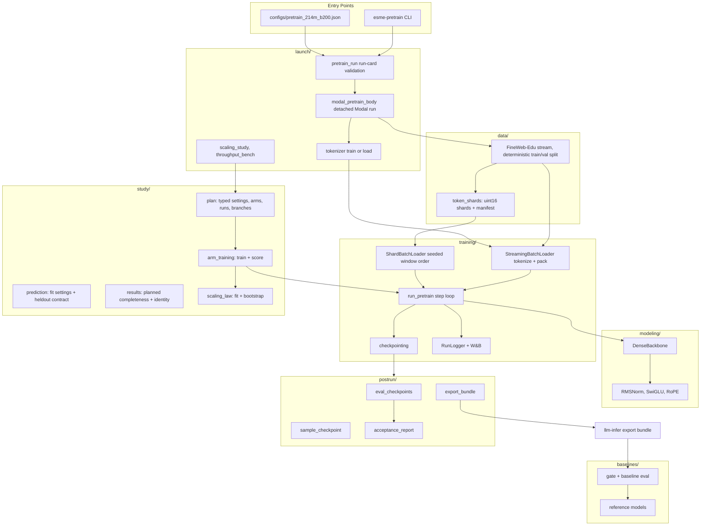

# Architecture

`Esme-214M-Base` is a dense decoder-only transformer defined in
[`src/esme_pretrain/modeling/`](../src/esme_pretrain/modeling/). It is not a fork
of a released model. The design uses current small-model defaults where they
make the training run simpler, stabler, and easier to serve.

## Pipeline Map



The `esme-pretrain` CLI also drives every `postrun/` and `baselines/` command
and the `scaling-fit` command. Those edges are left out of the map.

Dependency direction stays simple:

```text
cli -> launch + postrun + baselines + study
launch -> study + pretrain_run
study -> data + training + modeling + artifacts
pretrain_run -> pretrain_config -> data + modeling
```

`study/plan.py` owns immutable study settings and run expansion.
`study/results.py` checks planned completeness, run identity, and fixed evaluation identity.
`study/lr_gate.py` validates the recorded sweep and applies its registered stop rule.
`study/prediction.py` owns fit settings and prediction validation.
The CLI parses arguments and writes output. Launch code owns Git checks and Modal execution.

`pretrain_config.py` defines the JSON structure.
`pretrain_run.py` enforces the accepted run policy and derives launch values.
Each launcher binds selected work, hardware, timeout, and cost into a typed plan before execution.
Dry runs and paid execution consume the same plan. `launch/budget.py` owns per-launch cost bounds.
`artifacts/hashes.py` and `data/token_bytes.py` provide shared hashing and byte accounting.
`artifacts/validators.py` provides the strict JSON key checks for config files.
`make check` type-checks every module under `src`, `scripts`, and `tests` with basedpyright strict, including new files.
Five import contracts protect study, launch, data/artifacts, modeling/torch, and training ownership.
Modeling stays independent. Data and training cannot depend on operation policy.

Study data paths are relative to the configured volume root.
The launch plan resolves tokenizer and manifest paths before execution.
Local staging preserves each manifest's relative shard paths and copies only referenced inputs.

A fit from `--results-dir` records validated source-row hashes, point-value hashes, and evaluation identity.
Its plan hash covers selected arms, inherited model settings, optimizer, data, evaluation, and heldout token budget.
Changing those inputs requires a new fit. Unselected arms and output paths do not affect the hash.
The heldout launcher checks this evidence without reopening gitignored source rows.
Source hashes support traceability. They do not authenticate manually edited artifacts.
Exploratory `--points` fits remain readable but cannot approve heldout evaluation.

The one production model implementation is
[`DenseBackbone`](../src/esme_pretrain/modeling/backbone.py); training, eval,
sampling, and export all build it from the same `BackboneConfig`.

## Run Flow

1. A run card is validated into `PretrainLaunchConfig`
   ([`pretrain_run.py`](../src/esme_pretrain/pretrain_run.py)); `--dry-run`
   prints the run shape and cost estimate without spending.
2. An approved launch spawns a detached Modal function.
   [`modal_pretrain_body`](../src/esme_pretrain/launch/modal_pretrain_body.py)
   loads or trains the digit-split tokenizer, then streams FineWeb-Edu
   documents through the deterministic train/validation split.
3. `StreamingBatchLoader` tokenizes and packs documents into fixed
   context-length token windows feeding `run_pretrain`, which owns the step
   loop, fixed-batch eval, checkpoints, and W&B metrics. All artifacts land on
   the run's Modal volume.
4. Post-run commands reload checkpoints for deterministic eval (the same
   validation token batches for every checkpoint), decoded samples, the
   acceptance report, and bundle export.
5. `baseline-gate` and `baseline-eval` compare the exported bundle against
   reference models on shared validation slices. The bundle is the only
   contract `llm-infer` consumes ([bundle-format.md](bundle-format.md)).

Experiments use the same training loop on pre-tokenized shards.
`study/plan.py` expands `configs/scaling_study.json` into runs, and
`launch/scaling_study.py` runs each arm in its own single-use B200 container.
Each run's validation loss is written to a Modal volume as soon as it is
scored. `study/results.py` verifies planned completeness before `study/scaling_law.py` fits those rows.

## Training And Measurement Conventions

These choices are deliberate, but a reader comparing runs needs to know them.

- **Packing.** Documents are joined with `<eos>` and cut into fixed
  `context_length + 1` windows. There is no document attention mask, so
  attention crosses `<eos>` boundaries, as in GPT-2-style packing.
- **Data order.** `ShardBatchLoader` cuts pre-tokenized shards into
  `context_length + 1` windows and reads them in a seeded permutation. Resume
  seeks to the next window in that order. The streaming loader that trained the
  base model reads documents in the dataset's order with no shuffle, so that
  run's WSD decay phase saw the last 20 percent of the stream.
- **Learning rate.** WSD: linear warmup, constant peak, then a cosine-shaped
  decay over the final `decay_fraction` of steps. The last optimizer step runs
  at exactly `min_lr`.
- **Cooldown branches.** A run with `branch_from` starts from another run's
  checkpoint (weights, optimizer state, and data offset) taken in its constant
  phase, and decays to its own shorter `max_steps`. Only `max_steps` may differ
  from the source run. In a CPU test, a branch matches a from-scratch run of the
  same schedule bit for bit. One long run therefore yields loss points at
  several token budgets.
- **Host syncs.** The loss returns device tensors, and forward plus loss are
  compiled as one graph. A training step reads the device once, after the last
  micro-batch: loss, grad norm, and loss components together. A non-finite step
  is refused before the optimizer applies it.
- **In-loop validation.** The loop reads `eval_batches` validation batches once
  at start and scores the same batches at every eval.
- **Scoring precision.** Training enables TF32 matmuls. Final evals score in
  true fp32 and restore the previous setting afterwards.
- **Resume.** A checkpoint (format 3) records the optimizer schedule. Resume
  refuses a run whose schedule differs (`max_steps`, LR, warmup, decay, weight
  decay, betas, grad clip). Batch shape may change, because the data offset is
  counted in tokens. Format 2 checkpoints, such as the base model's, load for
  eval and export but cannot be resumed.
- **Bits per byte.** Each UTF-8 byte of a document is assigned to exactly one
  token, so token byte counts sum to the document length. `<eos>` adds loss
  but no bytes. The post-run eval and the baseline harness use the same rule.
- **FLOPs and MFU.** FLOPs per token are `6N + 12 * layers * d_model * context`,
  with the tied embedding counted once in `N` for the LM head matmul. The
  attention term counts the full matrix, not the causal half, so MFU reads
  slightly high.

## Model At A Glance

- 213,960,192 parameters.
- 30 layers, `d_model=768`, context length `1024`, vocab `32768`.
- Grouped-query attention with 12 query heads and 4 KV heads.
- `head_dim=64`, SwiGLU MLP with `d_ff=2048`, tied input/output embeddings.
- RoPE positions, RMSNorm, QK-norm, no biases, pre-norm residual blocks.
- Final-logit z-loss during training.
- Digit-split byte-level BPE tokenizer.

The checked-in [`pretrain_214m_b200`](../configs/pretrain_214m_b200.json)
configuration records the current 10B-token run shape.

## Design Choices

| Technique                            | Role in this model                                                           |
| ------------------------------------ | ---------------------------------------------------------------------------- |
| Decoder-only, pre-norm residuals     | Standard autoregressive LM stack; pre-norm keeps deep training stable        |
| RMSNorm                              | Bias-free normalization on the residual stream and Q/K                       |
| RoPE                                 | Relative position without a learned position table                           |
| SwiGLU MLP                           | Gated feed-forward block with strong small-model performance                 |
| GQA                                  | Smaller KV cache and faster attention with little quality cost at this scale |
| QK-norm                              | Bounds attention logits for training stability                               |
| Tied embeddings                      | Saves parameters at small scale                                              |
| Final-logit z-loss                   | Keeps the softmax denominator bounded                                        |
| Residual-projection init scaling     | Keeps residual-stream variance stable at initialization                      |
| FlashAttention-compatible dimensions | Uses the fast attention kernel path                                          |
| Digit-split tokenizer                | Tokenizes numbers as single-digit sequences                                  |

## Geometry

At this parameter budget, a deeper-and-narrower dense model is a good default.
The current shape uses 30 layers at `d_model=768`, which keeps the deep/thin
recipe while leaving enough feed-forward capacity for posttraining and serving.

Qwen3 is the closest current reference for the modern dense transformer stack.
MobileLLM is the main reference for the deep/thin thesis at sub-billion scale.
SmolLM2 is a useful nearby small-model comparison point. The public reference
list lives at the bottom of the root [`README.md`](../README.md).

The code, tokenizer, weights, and training artifacts are all local to this repo.

Decoded samples are generated after training from a saved checkpoint and its
tokenizer. Training RNG state, throughput measurements, and resume behavior are
left unchanged by sampling.

## Deliberately Not Used

| Technique                               | Why it is out of scope for this base model                                        |
| --------------------------------------- | --------------------------------------------------------------------------------- |
| Logit soft-capping                      | QK-norm plus z-loss cover the stability goal without adding another logit clamp.  |
| MLA                                     | Useful for large-scale KV-cache efficiency; GQA is enough at 214M.                |
| MoE                                     | A scale-out capacity technique; this model stays dense.                           |
| MTP                                     | A training/decoding-speed feature left out of the current base.                   |
| Sliding-window / local-global attention | Long-context efficiency is unnecessary at context length `1024`.                  |
| Muon / μP / sandwich-norm               | Avoided to keep the current base low-risk and easy to reproduce.                  |
